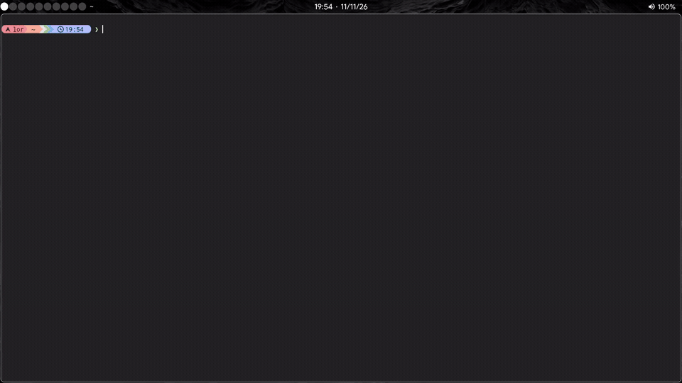
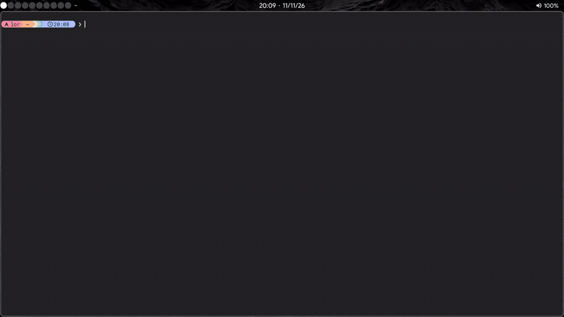
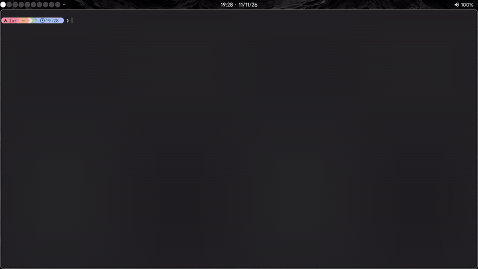

# `nvim-for-stem`

**Zero-friction Neovim configuration for STEM students, mathematicians, and researchers — combining live LaTeX typesetting, context-aware math snippets, scientific Python tooling, and Markdown note-taking.**

[](https://neovim.io/)
[](https://www.lua.org/)
[](LICENSE)
[](#quick-installation)

---

## Philosophy & Gilles Castel Inspiration

Taking mathematical notes or authoring technical papers should happen at the speed of thought. Every extra keystroke spent balancing braces, typing `\frac{}{}`, or manually triggering a PDF rebuild pulls focus away from the underlying mathematics.

This configuration is directly inspired by **Gilles Castel**'s landmark workflow (*["How I'm able to take notes in mathematics lectures using LaTeX and Vim"](https://castel.dev/post/lecture-notes-1/)*) and brings that paradigm to a modern, pure-Lua Neovim stack:

- **Pure-Lua Auto-Expanding Snippets (`LuaSnip v2`)**: Migrated from UltiSnips to `LuaSnip` with `enable_autosnippets = true` and `ecma` regex triggers (`regTrig = true`), providing **115 snippet rules (92 autosnippets)** for fractions (`a/`, `(x+y)/`), auto-subscripts (`x1`, `x_12`), Greek letters, blackboard bold sets, and environments.
- **Hybrid Math-Zone Detection (`snippets/tex_utils.lua`)**: Math-only snippets trigger exclusively inside math zones and are suppressed inside `\text{...}` commands. Detection combines:
  1. **VimTeX** (`vimtex#syntax#in_mathzone()`) for `.tex` files,
  2. **Treesitter AST** inspection (`inline_formula`, `displayed_equation`, `math_environment`, `latex_block`) with injection awareness, and
  3. **Multi-line buffer scanner** fallback for `$ ... $`, `$$ ... $$`, and standard LaTeX math environments (`equation`, `align`, `cases`, `matrix`, etc.).
- **Unified Math Authoring Across LaTeX & Markdown**: `LuaSnip` extends `markdown` with the `tex` snippet library (`ls.filetype_extend('markdown', { 'tex' })`), while display-math (`dm`) automatically adapts between `\[ ... \]` in `.tex` and `$$ ... $$` in `.md`.
- **Hands-Free Build & SyncTeX**: `.tex` buffers auto-save after `3000 ms` of inactivity (`CursorHold` / `CursorHoldI`), feeding `latexmk` + `texlab` and bidirectional SyncTeX in Zathura (Linux), Skim (macOS), or SumatraPDF (Windows).

---

## Visual Showcase

### LaTeX Live Authoring & SyncTeX



*Live authoring in `test.tex`: auto-expanding `LuaSnip` math delimiters (`dm`, `mk`), integrals (`int`), blackboard bold sets (`RR`), Greek auto-triggers (`\theta`, `\pi`), visual bold wrapping, `<C-o>` compilation with VimTeX/`latexmk`, and side-by-side Zathura PDF rendering with bidirectional SyncTeX inverse search.*

### Python Scientific Environment & LSP



*Editing `test.py` with Pyright LSP diagnostics and `nvim-cmp` autocompletion, rainbow `indent-blankline` guides, `nvim-ufo` Treesitter-backed code folding, Black auto-formatting on save via `conform.nvim`, and single-key execution (`;r`) in a right vertical split terminal.*

### Markdown & Technical Note-Taking



*Technical note-taking in `test.md`: the same `LuaSnip` math-zone triggers (`dm`, `//` fractions, `int`, Greek tokens) expand natively inside Markdown buffers while `markdown-preview.nvim` (`;mp`) renders `[toc]` navigation and KaTeX equations in real time.*

---

## Modular Architecture

The repository provides OS-tailored configuration trees with identical workflows and keybindings, differing only in PDF viewer SyncTeX integration and platform build hooks:

```text
nvim-for-stem/
├── assets/                          # Compressed demo GIFs for documentation
├── linux/                           # Linux config (Zathura + xdotool / Wayland-safe SyncTeX)
├── macos/                           # macOS config (Skim displayline SyncTeX)
├── windows/                         # Windows config (SumatraPDF + Zig/GCC/CL Treesitter compilers)
├── install_linux.sh                 # Automated installer for Arch (pacman) & Debian/Ubuntu (apt)
├── install_macos.sh                 # Automated installer for macOS (Homebrew)
├── install_windows.bat              # Windows installer entrypoint
├── windows_install_backend.ps1      # PowerShell installer (Winget + SumatraPDF inverse search)
├── uninstall_linux.sh               # Interactive Linux uninstaller
├── uninstall_macos.sh               # Interactive macOS uninstaller
├── uninstall_windows.bat            # Windows uninstaller entrypoint
├── windows_uninstall_backend.ps1    # PowerShell uninstaller
├── README.md                        # English documentation
├── README_ITA.md                    # Italian documentation
└── LICENSE                          # MIT License
```

Each OS directory (`linux/`, `macos/`, `windows/`) follows a clean modular layout:

```text
<os>/
├── init.lua                         # lazy.nvim bootstrap, pynvim/nvr check, module loader
└── lua/
    ├── config/
    │   ├── options.lua              # Leader key (;), relative numbers, Italian spelllang, guicursor, completeopt
    │   ├── keymaps.lua              # Window cycling, visual indent/wrapping, LaTeX formatting & compile
    │   └── autocmds.lua             # Custom CursorLineNr (#f48c06) & TexMathDelimiter (#bb70d2) highlights
    ├── plugins/
    │   ├── ui.lua                   # alpha-nvim dashboard, onedark (warmer), lualine, rainbow indent-blankline
    │   ├── editor.lua               # nvim-tree, fzf.vim, outline.nvim, nvim-autopairs, nvim-ufo, copilot.vim, markdown plugins
    │   ├── completion.lua           # LuaSnip v2 (autosnippets + markdown->tex) & nvim-cmp (LSP, buffer, path, cmdline)
    │   ├── lsp.lua                  # Neovim 0.11+ native vim.lsp.config for texlab & pyright
    │   ├── treesitter.lua           # nvim-treesitter parsers (lua, python, js, html, css, latex, markdown)
    │   └── languages/
    │       ├── latex.lua            # VimTeX viewer config, 3s auto-save on *.tex, Wayland inverse-search optimization
    │       └── python.lua           # conform.nvim (Black on save), nvim-dap / nvim-dap-python, <Leader>r split runner
    └── snippets/
        ├── tex.lua                  # 115 LuaSnip rules (92 autosnippets) across 9 categories
        └── tex_utils.lua            # Hybrid in_mathzone (VimTeX -> Treesitter -> buffer scanner), get_visual, line_begin
```

### Platform-Specific Differences

| Component | Linux (`linux/`) | macOS (`macos/`) | Windows (`windows/`) |
| :--- | :--- | :--- | :--- |
| **PDF Viewer (VimTeX & `texlab`)** | `zathura_simple` (`zathura --synctex-forward`) | `skim` (`/Applications/Skim.app/.../displayline`) | `general` (`SumatraPDF.exe -reuse-instance -forward-search`) |
| **Inverse Search** | Minimal `nvim --clean` callback (avoids Wayland RAM leaks) | Skim SyncTeX preset | Configured in `SumatraPDF-settings.txt` via `nvr` |
| **LuaSnip `jsregexp`** | Built via `make install_jsregexp` | Built via `make install_jsregexp` | Pure Lua / `ecma` engine (no `make` build step) |
| **Treesitter Compilers** | System `gcc` | System `clang` / `gcc` | `zig`, `gcc`, `clang`, `cl` (`prefer_git = true`) |
| **`markdown-preview.nvim`** | `mkdp#util#install()` | `mkdp#util#install()` | `cd app && yarn install` |

---

## Keybindings & Snippets Cheat-Sheet

> **Leader key:** `;` (semicolon)

### General, Navigation & Folding

| Key | Mode | Action | Source |
| :--- | :--- | :--- | :--- |
| `f` / `r` / `e` / `c` / `u` / `q` | Dashboard | Find files (`~/Documents/uni/`), Recent, New file, Config, `:Lazy sync`, Quit | [`ui.lua`](linux/lua/plugins/ui.lua) |
| `<Tab>` / `<S-Tab>` | Normal | Focus next / previous window split | [`keymaps.lua`](linux/lua/config/keymaps.lua) |
| `<C-n>` | Normal | Toggle `nvim-tree` rooted at `~/Documents/uni` | [`editor.lua`](linux/lua/plugins/editor.lua) |
| `<C-k>` | Normal | Toggle document symbol `Outline` | [`editor.lua`](linux/lua/plugins/editor.lua) |
| `zR` / `zM` | Normal | Open all folds / Close all folds (`nvim-ufo`) | [`editor.lua`](linux/lua/plugins/editor.lua) |
| `za` / `zo` / `zc` | Normal | Toggle / Open / Close fold under cursor | Built-in / `nvim-ufo` |

### Visual Mode Editing

| Key | Mode | Action | Source |
| :--- | :--- | :--- | :--- |
| `<Tab>` / `<S-Tab>` | Visual (`x`) | Indent / unindent lines while keeping visual selection (Select mode left intact for snippets) | [`keymaps.lua`](linux/lua/config/keymaps.lua) |
| `'`, `"`, `$` | Visual (`v`) | Wrap selection in `'...'`, `"..."`, or `$...$` and keep selection | [`keymaps.lua`](linux/lua/config/keymaps.lua) |
| `(`, `[`, `{` | Visual (`v`) | Wrap selection in `(...)`, `[...]`, or `{...}` and keep selection | [`keymaps.lua`](linux/lua/config/keymaps.lua) |
| `<M-b>` / `<M-i>` | Visual (`v`) | Wrap selection in `\textbf{...}` / `\textit{...}` | [`keymaps.lua`](linux/lua/config/keymaps.lua) |

### Insert Mode Completion, Snippets & AI

| Key | Mode | Action | Source |
| :--- | :--- | :--- | :--- |
| `<Tab>` / `<S-Tab>` | Insert / Select | Expand `LuaSnip` snippet or jump forward / backward across placeholders | [`completion.lua`](linux/lua/plugins/completion.lua) |
| `<CR>` | Insert | Confirm `nvim-cmp` selection (`select = false`) | [`completion.lua`](linux/lua/plugins/completion.lua) |
| `<C-j>` | Insert / Select | Select next `nvim-cmp` item | [`completion.lua`](linux/lua/plugins/completion.lua) |
| `<Up>` / `<Down>` | Insert / Select | Navigate `nvim-cmp` menu when an entry is selected | [`completion.lua`](linux/lua/plugins/completion.lua) |
| `<M-Space>` | Insert | Accept GitHub Copilot suggestion (`copilot_no_tab_map = true`) | [`editor.lua`](linux/lua/plugins/editor.lua) |
| `<C-l>` | Insert | Auto-fix previous misspelled word using Vim spellcheck (`[s1z=`) | [`keymaps.lua`](linux/lua/config/keymaps.lua) |

### Language Actions

| Key | Mode | Action | Source |
| :--- | :--- | :--- | :--- |
| `<C-o>` | Normal | Save buffer and run `:VimtexCompile` | [`keymaps.lua`](linux/lua/config/keymaps.lua) |
| `;r` (`<Leader>r`) | Normal | Save and run current Python file in a right vertical split terminal | [`python.lua`](linux/lua/plugins/languages/python.lua) |
| `;mp` (`<Leader>mp`) | Normal | Toggle live browser preview (`:MarkdownPreviewToggle`) | [`editor.lua`](linux/lua/plugins/editor.lua) |

### LaTeX & Markdown Snippets (`lua/snippets/tex.lua`)

`lua/snippets/tex.lua` defines **115 snippet rules (92 autosnippets)** across 9 categories, active in both `.tex` and `.md` buffers. Rules marked `(Tab)` require pressing `<Tab>`; all others auto-expand immediately.

| Category | Triggers | Notes & Context |
| :--- | :--- | :--- |
| **1. Document & Environments** | `template` (Tab), `beg`, `table` (Tab), `fig` (Tab), `enum`, `item`, `desc` (Tab), `pac` (Tab), `ali`, `case`, `bigfun`, `SI`, `letw` | Line-start environments (`beg`, `enum`, `item`, `ali`, etc.) and common macros |
| **2. Math Delimiters** | `mk`, `dm`, `...` | `mk` -> `$...$`; `dm` -> `\[...\]` (`.tex`) or `$$...$$` (`.md`); `...` -> `\ldots` |
| **3. Fractions & Calculus** | `//`, `7/`, `\alpha/`, `(1+2)/`, `sqrt`, `int`, `part` (Tab), `sum` (Tab), `taylor` (Tab), `lim` (Tab), `limsup` (Tab), `prod` (Tab) | Math zone; regex fraction captures balanced parens or tokens before `/` |
| **4. Matrices & Delimiters** | `pmat`, `bmat`, `cvec`, `()` (Tab), `\|\|` (Tab), `{}` (Tab), `[]` (Tab), `lra`, `ceil`, `floor`, `conj`, `norm`, `mcal`, `bf`, `txt`, `sts` | `pmat`, `ceil`, `floor`, `txt` work anywhere; others gated by `in_mathzone` |
| **5. Powers & Subscripts** | `sr` (`^2`), `cb` (`^3`), `td` (`^{}`), `__` (`_{}`), `x1` -> `x_1`, `x_12` -> `x_{12}`, `xnn`, `ynn`, `xii`, `yii`, `xjj`, `yjj`, `xp1`, `xmm`, `R0+`, `rij` (Tab) | Math zone; supports automatic single- and double-digit subscripts |
| **6. Symbols, Sets & Logic** | `==`, `!=`, `<=`, `>=`, `=>`, `=<`, `iff`, `->`, `<->`, `!>`, `invs`, `cmpl`, `\\\`, `>>`, `<<`, `~~`, `ooo`, `lll`, `nabl`, `xx`, `**`, `eps`, `<!`, `<>`, `set`, `sbst`, `notin`, `inn`, `Nn`, `UU`, `uuu`, `nnn`, `OO`, `NN`, `RR`, `QQ`, `ZZ`, `HH`, `DD`, `Ee`, `EE`, `AA`, `PP` | All 43 triggers are math-zone autosnippets |
| **7. Accents, Trig & Greek** | `bar`, `xbar`, `hat`, `xhat`; `sin`, `cos`, `arccot`, `cot`, `csc`, `ln`, `log`, `exp`, `star`, `perp`; `arcsin`, `arccos`, `arctan`, `arccsc`, `arcsec`, `pi`, `zeta`, `to`, `delta`, `kappa`, `lambda`, `mu`, `nu`, `rho`, `sigma`, `tau`, `omega` | Math zone; auto-prefixes `\` unless already preceded by `\` |
| **8. Symbolic Evaluation** | `sympy` (Tab) -> `sympy ... sympy` (Tab), `math` (Tab) -> `math ... math` (Tab) | Evaluates expressions via `python3` (`sympy`) or `wolframscript` into LaTeX |
| **9. TikZ & PGFPlots** | `plot` (Tab), `surf` (Tab), `node` (Tab) | 2D axis plot, 3D surface (`colormap/viridis`), and TikZ node templates |

---

## Quick Installation

Each installer script supports **English** and **Italian** prompts, lets you customize your default workspace path for `nvim-tree` and `FZF` (default: `~/Documents/uni`), installs system tools and **RobotoMono Nerd Font**, and copies the OS-specific configuration into Neovim's config directory.

### Automated Installers

- **Linux** (Arch `pacman` & Debian/Ubuntu `apt`):
  ```bash
  git clone https://github.com/Lorenzo1901/nvim.git && cd nvim && bash install_linux.sh
  ```
- **macOS** (Homebrew):
  ```bash
  git clone https://github.com/Lorenzo1901/nvim.git && cd nvim && bash install_macos.sh
  ```
- **Windows** (`winget`, Windows 10/11):
  ```cmd
  git clone https://github.com/Lorenzo1901/nvim.git && cd nvim && install_windows.bat
  ```

After installation:
1. Set your terminal font to **`RobotoMono Nerd Font`**.
2. Launch `nvim` — `lazy.nvim` will automatically clone and build all plugins (and `nvim-treesitter` parsers).
3. Run `:checkhealth` to verify LSP, Python, and TeX integrations.

### System Prerequisites

The automated scripts handle these dependencies, or you can install them manually:

| Category | Linux (`pacman` / `apt`) | macOS (`brew`) | Windows (`winget` / manual) |
| :--- | :--- | :--- | :--- |
| **Core Editor & CLI** | `neovim` (>= 0.11), `git`, `ripgrep`, `fzf`, `nodejs`, `npm`, `luarocks`, `perl`, `ffmpeg`, `base-devel` / `build-essential`, `pkgconf` / `pkg-config`, `cairo`, `pango` | `neovim` (>= 0.11), `git`, `ripgrep`, `fzf`, `node`, `luarocks`, `perl`, `ffmpeg`, `pkg-config`, `cairo`, `pango` | `Neovim.Neovim`, `Git.Git`, `BurntSushi.ripgrep.MSVC`, `junegunn.fzf`, `OpenJS.NodeJS`, `DEVCOM.Lua`, `StrawberryPerl.StrawberryPerl`, `Gyan.FFmpeg`, Visual Studio 2022 Build Tools |
| **LaTeX & SyncTeX** | `texlive-meta` / `texlive-full`, `texlab`, `zathura`, `zathura-pdf-mupdf`, `xdotool` | `mactex` (cask), `texlab`, `skim` (cask) | `MiKTeX.MiKTeX`, `texlab` (GitHub release), `SumatraPDF.SumatraPDF` |
| **Python & LSP** | `python3`, `pip3`, `pyright` (`npm -g`), `pynvim`, `neovim-remote`, `black`, `manim` (`pip3`) | `python`, `pyright` & `tree-sitter-cli` (`npm -g`), `pynvim`, `neovim-remote`, `black`, `manim` (`pip3`) | `Python.Python.3.11`, `pyright`, `tree-sitter-cli`, `yarn`, `neovim` (`npm -g`), `pynvim`, `neovim-remote`, `black`, `manim` (`pip`) |
| **Font** | `RobotoMono Nerd Font` (`~/.local/share/fonts/RobotoMonoNerd`) | `font-roboto-mono-nerd-font` (cask) | `RobotoMono Nerd Font` (`AppData\Local\Microsoft\Windows\Fonts`) |
| **Optional (Snippets)** | `sympy` (`pip`), `wolframscript` | `sympy` (`pip`), `wolframscript` | `sympy` (`pip`), `wolframscript` |

### Uninstallation

Interactive uninstallers prompt before removing each component:
- **Linux**: `bash uninstall_linux.sh`
- **macOS**: `bash uninstall_macos.sh`
- **Windows**: `uninstall_windows.bat`

---

## License & Third-Party Disclaimer

The [MIT License](LICENSE) in this repository applies **only to the configuration files, snippets, and installation scripts** authored in this repository.

All third-party Neovim plugins managed via `lazy.nvim` (e.g., `lazy.nvim`, `vimtex`, `LuaSnip`, `nvim-cmp`, `nvim-lspconfig`, `nvim-treesitter`, `conform.nvim`, `render-markdown.nvim`, `markdown-preview.nvim`, `copilot.vim`, etc.) are developed by their respective authors and remain governed by their own licenses.
